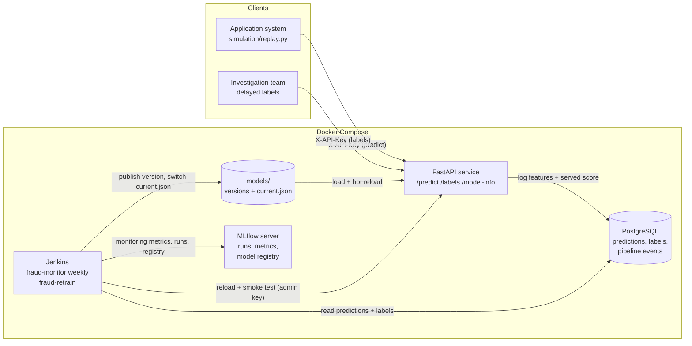

# Fraud detection for a government agency — from model to production

IU course DLBDSMTP01 "Project: From Model to Production", **Task 3 (spotlight: MLOps)**.

A CatBoost model scores benefit applications for fraud. The score only decides which
applications a person reviews first — it never rejects anybody. The model runs as a
REST service, every prediction is logged, labels arrive one month later, a weekly
Jenkins job monitors drift and performance, and Jenkins retrains and redeploys the
model every month or earlier when the data changes. One year of drifting data is
simulated to test the whole loop.

## Architecture



| Part | File(s) | What it does |
| --- | --- | --- |
| Data splits | `prepare_data.py`, `get_data.py` | Time-ordered splits of the BAF `Base.csv` (train / val / test / simulation pool / reserve). |
| Model training | `train.py`, `tune.py`, `preprocessing.py` | CatBoost, Optuna search for max. recall with FPR < 5 %. |
| Baseline | `baseline.py` | Logistic regression with the same data and threshold rule, to justify CatBoost. |
| Probabilities | `scoring.py`, `package_model.py` | Corrects the class-weighted scores to real probabilities; builds deployable bundle v1. |
| REST API | `service/api.py`, `service/schemas.py`, `service/db.py` | Scoring, validation, API keys with roles, prediction log, label import, hot model reload. |
| Drift + fairness | `drift.py`, `fairness.py` | PSI per feature, importance-weighted drift share, quality checks, FPR by age group. |
| Monitoring job | `pipeline/monitor.py`, `jenkins/monitor.Jenkinsfile` | Weekly: data drift, data quality, delayed-label performance → retrain decision; label-free workload threshold (fast loop). |
| Retraining job | `pipeline/retrain.py`, `jenkins/retrain.Jenkinsfile` | Snapshot → train → evaluate (promotion gate) → register → deploy + smoke test + rollback. |
| Model registry | `model_registry.py`, MLflow registry | `models/current.json` decides what the API serves; MLflow keeps every candidate. |
| Simulation | `simulation/build_months.py`, `simulation/replay.py`, `simulation/summarize.py` | 12 months with injected drift, replayed week by week through the REST API. |
| Deployment | `docker-compose.yml`, `docker/`, `jenkins/` | API, PostgreSQL, MLflow (login), Jenkins (configuration as code). |

## Setup

Python 3.12, then:

```powershell
python -m pip install -r requirements.txt
```

The dataset is not in git (213 MB). Download `Base.csv` from Kaggle
("Bank Account Fraud Dataset Suite (NeurIPS 2022)") into `data/raw/`, then:

```powershell
python get_data.py                  # checks the SHA-256 and creates data/splits/
python package_model.py             # initial_model/ -> models/versions/v1 (+ deploys it)
python -m simulation.build_months   # 12 simulated months -> data/simulation/
python -m unittest discover -s tests -t .
```

## Run everything with Docker (recommended)

> Status: tested on 29 September 2026 with the second version of the pipeline. The full simulated
> year ran through Jenkins in Docker (52 monitor builds, 13 retrain builds); the three
> realistic-label years ran locally with the same code.

```powershell
copy .env.example .env              # then replace every value with a random one
docker compose up -d --build
```

Jenkins only runs **committed and tested** code. About a minute after start-up `fraud-ci` checks out
the newest commit on `main` (`GIT_BRANCH` in `.env`) from this repository, which is mounted read-only
(`GIT_REPO_URL` can point to GitHub instead), and runs: environment check against `requirements.lock`,
unit tests, and a training smoke test on real data. A green commit is pushed to a release repository inside Jenkins;
`fraud-monitor` and `fraud-retrain` load their Jenkinsfile and code only from there. Until the first
green CI build they fail with "no release yet". Every model bundle records the commit, the SHA-256 of
its training data and the library versions (`metadata.json`, `/model-info`, MLflow tag `git_commit`).

```text
commit -> fraud-ci (env check, tests, smoke test) --green--> release.git -> fraud-monitor / fraud-retrain
```

Both images install exact versions from lock files (`requirements.lock`, `requirements-api.lock`,
generated from `requirements*.txt` with `uv pip compile`; command in the file header), with Python
3.12 in both. The API refuses a model that another CatBoost version wrote.

| Service | URL | Login |
| --- | --- | --- |
| REST API docs | http://localhost:8000/docs | `X-API-Key` header (keys in `.env`) |
| Jenkins | http://localhost:8080 | `JENKINS_ADMIN_ID` / `JENKINS_ADMIN_PASSWORD` |
| MLflow | http://localhost:5000 | `admin` / `MLFLOW_ADMIN_PASSWORD` |

Replay the simulated year. Jenkins decides every week and retrains when needed:

```powershell
python -m simulation.replay --pipeline jenkins
docker compose exec -w /project jenkins python -m simulation.summarize --output /reports
```

By default every application gets its true label 4 weeks later. `--label-mode realistic`
only labels the flagged (reviewed) applications plus a random 2 % audit of the others,
weighted by 1 / audit share; the rest stays unknown. `--audit-seed N` draws the audit sample
with another seed. See section 6 of RESULTS.md.

Several local runs can run at the same time, each with its own port, database and models folder:

```bash
bash work/runs/run_local.sh realistic_a 8101 realistic        # default audit sample
bash work/runs/run_local.sh realistic_b 8102 realistic 1      # audit seed 1
```
The tables end up in `work/docker_reports/` (the local runs write to `work/runs/<name>/report/`).
Charts and the comparison table are made from them with:

```powershell
python -m simulation.presentation_charts --results work/docker_reports --realistic work/runs/realistic_a/report --output docs/results/charts
python -m simulation.guide_charts
python -m simulation.compare_runs --run all_labels=work/docker_reports --run realistic_a=work/runs/realistic_a/report
```

`docs/presentation/` still holds the charts of the first version (the ones in the current slides).

To start again from v1, run `docker compose down -v`, delete `models/` and run
`python package_model.py`.

## Run without Docker

The same Python jobs can run in one process (SQLite instead of PostgreSQL, local MLflow):

```powershell
$env:API_KEY_ADMIN="..."; $env:API_KEY_PREDICT="..."; $env:API_KEY_LABELS="..."   # or use .env
uvicorn service.api:create_app --factory --port 8000
python -m simulation.replay --pipeline local      # in a second terminal
python -m simulation.summarize
```

## Example request

```powershell
curl -X POST http://localhost:8000/predict -H "X-API-Key: <predict key>" -H "Content-Type: application/json" -d "@example_request.json"
```

```json
{"prediction_id": "0b0c…", "application_id": "APP-1", "fraud_probability": 0.0151,
 "flagged_for_review": false, "threshold": 0.0550, "model_version": "v3",
 "scored_at": "2026-09-28T14:10:06", "duplicate": false}
```

Missing values are sent as `null`. Unknown fields, missing fields and non-numbers are
rejected with HTTP 422. Sending the same request twice returns the stored result
(`duplicate: true`), so clients can safely retry.

## How drift is simulated (`configs/drift_scenario.json`)

The labels in BAF are real, so adding noise to features would not be a realistic
drift. Every drift type keeps the rows consistent:

| Months | Injected change | Type | Expected signal |
| --- | --- | --- | --- |
| 1–2 | none (control) | – | nothing |
| 3–12 | "downturn": rows kept depending on income and address (rejection sampling), and more applications (16,000 → 20,000 per month) | covariate shift | small — should *not* alarm |
| 4–12 | some legitimate rows dropped | prior shift | fraud rate ↑ |
| 5–12 | new credit bureau: `credit_risk_score` + 600 | upstream change | PSI on an important feature, alert rate |
| 7–12 | 20–50 % of fraud cases copy normal applicants' top signals | concept drift | almost invisible in the data → only delayed labels |
| 10 | 30 % via a new mobile form: no session length, unknown device | data-quality incident | block retraining, alert |

The simulation also keeps the natural drift between the real BAF months 4–7. Each month keeps
pool rows (in their original order) until it has its planned number of applications, so the
downturn months are the biggest ones and no row is used twice.

## Retraining rules (`configs/monitoring.json`, `configs/retraining.json`)

- **Schedule:** 28 days after the last training.
- **Data drift:** importance-weighted drift share ≥ 0.25, or PSI ≥ 0.25 on a feature
  with ≥ 5 % model importance, or the alert rate moved by ≥ 4 standard errors.
  Because labels arrive 4 weeks late, a drift alarm waits until ≥ 3,000 applications
  from the drifted period are labelled.
- **Performance:** recall of the served scores below a fixed target of 49 % (v1's validation
  recall at the 5.5 % review share minus 10 pp; before, each model was compared with its own noisy
  holdout recall, which fell with the drift), or FPR above 6 % (≥ 100 fraud labels in the last 28 days). Recall is only judged
  with ≥ 20 labelled frauds that the model missed (with realistic labels these only come from
  the audit, otherwise the estimate is meaningless).
- **Blocked** during data-quality incidents; 14-day cooldown; ≥ 12,000 new labels needed.
- **Fast loop (no labels):** every week the served threshold is reset so that 5.5 % of last
  week's applications would have been sent to review (review capacity). Written to
  `models/current.json`, picked up by the API without a restart; not changed during a
  data-quality incident.
- **Training:** CPU CatBoost with the tuned hyperparameters and a fixed 377 trees (no early
  stopping: on selectively labelled validation data it stopped after 1–2 trees).
- **Calibration:** the API returns probabilities, so the weekly job also checks them against the
  delayed labels (Brier score, ECE, mean probability / fraud rate; warning outside 0.67–1.5). Each
  retrained model is recalibrated on its holdout with one odds factor (mean probability = fraud rate);
  the order of the applications, and so the review list, does not change.
- **Promotion gate:** candidate and champion on the same newest holdout, both at the same
  workload (5.5 % of all applications of the holdout weeks). Sanity check (average precision
  ≥ 2× the fraud rate), then promote if the recall is at most 2 pp lower (paired bootstrap
  interval reported). With fewer than 10 labelled missed frauds recall cannot be compared: the
  newer model is promoted unless it flags more than 15 pp fewer of the known (reviewed) frauds.

## Results

Full year in [RESULTS.md](RESULTS.md). In short (all labels, 229,000 applications):

| | Recall | FPR | Sent to review | Fraud in top 5 % |
| --- | ---: | ---: | ---: | ---: |
| Both loops (retraining + workload threshold) | 48.0 % | 5.2 % | 5.8 % | 44.9 % |
| Fast loop only (frozen v1 + workload threshold) | 47.2 % | 5.1 % | 5.7 % | 43.9 % |
| No MLOps (frozen v1, fixed threshold) | 55.5 % | 7.9 % | 8.5 % | 43.9 % |

- Every injected change was detected by the signal it was designed for; after the new
  credit-bureau scale the review share was back to plan after **one week**.
- 12 trainings, 10 promoted, 2 rejected by the gate, retraining blocked during the data-quality
  incident.
- The fast loop does most of the work (a third fewer reviews than the frozen model); retraining
  adds a modest ranking gain with all labels and none with realistic labels (three audit samples:
  recall 46.9–47.6 %, recall never measurable).


## Access control

- Four API keys with different roles (predict, labels, monitor, admin); keys ≥ 16
  characters, compared in constant time, never in the code (`.env` is git-ignored).
- PostgreSQL has no published port; all ports are bound to `127.0.0.1`.
- MLflow runs with the basic-auth app; Jenkins has no anonymous access.
- The API container runs as a non-root user and mounts the models read-only.
- Logs never contain application features.

## Limitations

- BAF is synthetic bank-account data, used as a stand-in for benefit applications.
  Some features (e.g. `velocity_6h`) need a backend that computes them at request time.
- In reality only reviewed applications get a label (selection bias). The main run releases
  labels for all applications; the realistic label mode shows that a 2 % audit is then far too
  small to measure recall or to show that a new model is better (RESULTS.md, section 6).
- The workload threshold keeps the number of reviews flat; in a real fraud wave more reviews
  might be needed (the alert-rate signal and the share of reviews that find fraud show it).
- The model flags legitimate applicants aged 50+ about four times as often as younger
  ones (FPR 13.1 % vs 3.1 %). This is monitored but not fixed.
- The 5 % FPR limit is met on validation data only; it is not a guarantee.
