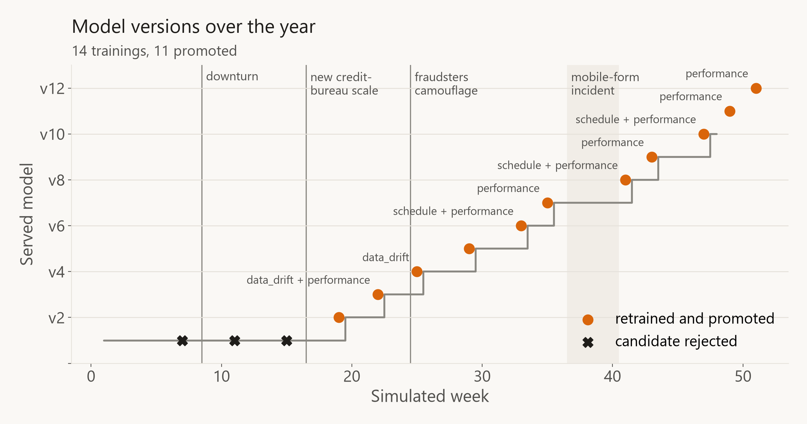
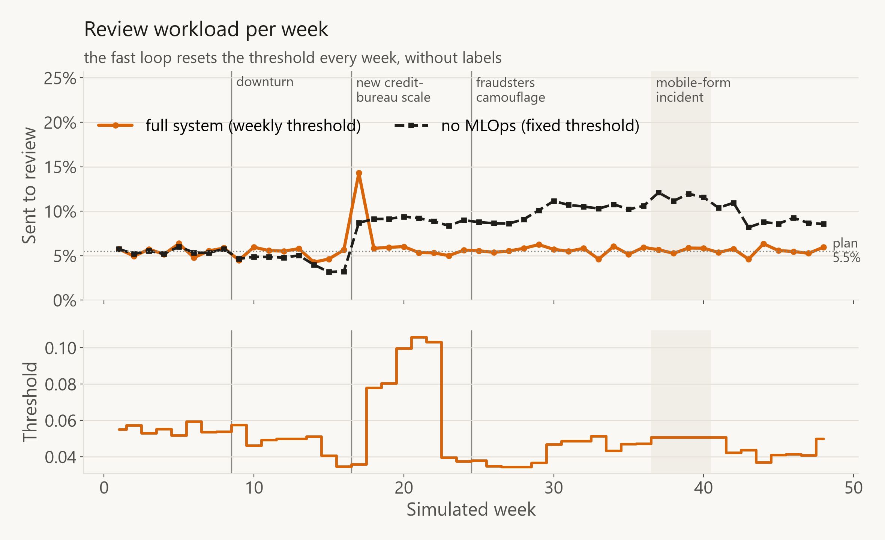
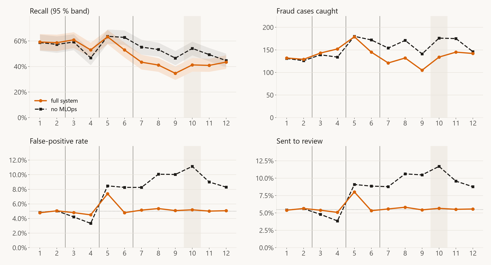
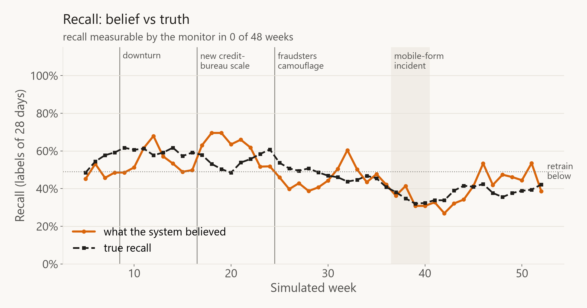
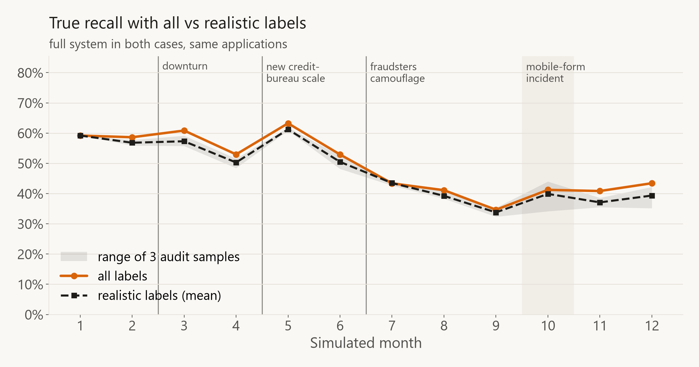

# Results of the simulated year

Final runs on 7 October 2026 with the fourth version of the pipeline (changes in section 1),
after a full reset (`docker compose down -v`, fresh `models/` with only v1):

- **All labels:** through the Docker Compose stack with Jenkins as the MLOps platform
  (`python -m simulation.replay --pipeline jenkins`: 52 `fraud-monitor` builds, none failed;
  14 `fraud-retrain` builds with training). Jenkins ran the commit that `fraud-ci` had tested and
  released (`6ce6e54`).
- **Realistic labels:** three runs with different random audit samples
  (`bash work/runs/run_local.sh realistic_a_v4 8101 realistic`, seeds 1 and 2 for b and c), each with
  its own API, database and models folder.

52 simulated weeks: 48 weeks of applications (**286,300** in total, 1.20 % fraud; 20,000 per month
before the downturn, 25,000 during it) plus 4 weeks in which only the last labels arrive. Labels
always arrive 4 weeks late. Tables: [docs/results/](docs/results/) (stays local). All charts are in
[charts/](charts/) and are made only from the result folders with `python -m simulation.plot_results`
(one folder per run, `charts/compare/` for the comparisons, see [docs/VISUALIZATION.md](docs/VISUALIZATION.md)). The numbers of the
earlier runs are in section 8.

## 1. What changed

### After the first runs (second version)

| Change | Why (what the first runs showed) |
| --- | --- |
| **Fast loop:** weekly label-free workload threshold (5.5 % of last week's applications) | After the credit-bureau change the old threshold sent 12–19 % to review for 8 weeks; the fix mainly came from a new threshold, which needs no labels |
| **Evidence rule:** recall only judged with ≥ 20 labelled missed frauds (monitor) / ≥ 10 (gate) | In one realistic week the monitor reported 100 % recall (true: 44 %) because no audited fraud was in the window |
| **Gate at equal workload**, FPR check only with the old threshold policy, sanity check (AP ≥ 2× fraud rate) | Thresholds chosen on ~570 weighted rows made candidates look bad; at equal workload the FPR says nothing new |
| **Known-fraud check** in the gate | A candidate that caught 24 % instead of 75 % of the reviewed frauds was promoted (see section 7) |
| **Fixed tree count (377)** instead of early stopping | With realistic labels early stopping kept 1–2 trees in a third of the retrainings |
| **API reload + confirmation** after a threshold change | In fast local runs only 2 of ~45 threshold changes reached the API in time |
| **Logistic-regression baseline**, **three audit seeds** | To justify CatBoost with a number and to see whether one realistic run is luck |

### For this run (after the runs of 29 September)

| Change | Why |
| --- | --- |
| **Audit 2 % → 5 %** of all applications (weight 50 → 20) | With 2 % recall was never measurable (only ~3 audited missed frauds per 4 weeks) |
| **Tail-only downturn**, months grow from 20,000 to 25,000 | The old downturn threw away 30 % of the pool rows for an income/address PSI of only 0.014 — smaller than the natural drift of BAF. Now only above-median rows are dropped (keeps ~88 % of the rows for the same shift) |
| **Fixed recall target (49 %)** for the performance trigger | Before, every model was compared with its own holdout recall, which fell with the drift, so the trigger got blind over time |
| **Calibration check** every week + **recalibration** of every retrained model | The API returns probabilities, so they have to stay probabilities |
| **CI + release repository**, lineage, lock files | Jenkins only runs tested commits; every bundle records the commit, the SHA-256 of its training data and the library versions |

## 2. Model before deployment

| Problem | Fix | Effect (validation) |
| --- | --- | --- |
| Scores were not probabilities (class weights inflate odds ~10x) | Prior correction in `scoring.py` | Mean score 8.5 % → 1.4 % (fraud rate 0.9 %); Brier 0.0273 → 0.0084; same applications flagged |
| Training only worked on my GPU | `configs/training_cpu.json`, `train.py --cpu` | Jenkins retrains on the CPU |
| No fairness check | FPR by age group in every evaluation | Applicants 50+: FPR 13.1 %, younger: 3.1 % (ratio 0.23) |
| No drift reference | `reference_profile.json` in every bundle | Monitoring compares with the data each model was accepted on |

Baseline (`baseline.py`, same split, same threshold rule, test set):

| | Logistic regression | CatBoost v1 |
| --- | ---: | ---: |
| Recall at FPR < 5 % | 53.1 % | **57.6 %** |
| Average precision | 0.144 | **0.177** |
| ROC AUC | 0.902 | **0.914** |

## 3. What the pipeline did (all labels)

| Decision (weekly monitoring) | Weeks |
| --- | ---: |
| no action | 22 |
| retrain | 16 |
| deferred — waiting for (drifted) labels | 10 |
| blocked / quality incident | 4 |

16 retraining decisions: **14 trainings, 11 promoted (v2–v12), 3 rejected**, 2 skipped (weeks 45 and
46: not enough labelled data outside the quarantined incident weeks). The threshold was reset every
week (except during the incident), the API confirmed each change, and it was smoke-tested after every
retraining.

| Week | Trigger | Result |
| ---: | --- | --- |
| 7, 11, 15 | schedule | **rejected**: candidate recall 2.8 / 2.9 / 4.5 pp lower than v1 (before the scale change the tuned v1 stays better) |
| 19 | schedule | promoted (v2) |
| 22 | data drift + performance | promoted (v3) |
| 25 | data drift | promoted (v4) |
| 29, 33 | schedule (+ performance) | promoted (v5, v6) |
| 35 | performance | promoted (v7) |
| 37–40 | — | **blocked** during the mobile-form incident |
| 41 | schedule + performance | promoted (v8) |
| 43 | performance | promoted (v9), but see below |
| 45, 46 | performance | **skipped**: not enough labelled data |
| 47, 49, 51 | (schedule +) performance | promoted (v10, v11, v12) |

v11 and v12 were deployed after the last applications (week 48), so they never scored anything; the
"served model" line therefore ends at v10.

**A wasted retraining (week 43).** The performance trigger fired again right after the 14-day
cooldown. The only new labels since v8 came from the incident weeks, which are quarantined, so v9 was
trained on exactly the same fit and holdout rows as v8 (same gate numbers, +0.00 pp). Harmless (the
gate promoted an equivalent model), but the "≥ 12,000 new labels" rule should only count labels that
can actually be used for training. Not fixed in this run.

## 4. How each injected change was detected

- **Downturn (months 3–12, tail-only rejection sampling + more applications):** drift share ≤ 0.034
  until week 13, so no data-drift alarm from the downturn itself — as intended. The alert-rate signal
  fell (z = −7.8 in week 15). In weeks 14–16 the drift share rose to 0.29–0.43 (PSI 0.20 on
  `name_email_similarity`): this is the **natural** drift when the pool moves from BAF month 4 to 5,
  not an injected change. The monitor waited for labels of the drifted period, and the scheduled
  candidate of week 15 was rejected.
- **New credit-bureau scale (from week 17):** found in the first week — PSI 8.28 on
  `credit_risk_score`, alert-rate z = +11.3. **Fast loop:** 14.3 % of the applications were sent to
  review in week 17 and 5.8 % in week 18; the frozen model with its fixed threshold sent 8–12 % for
  the rest of the year (9.7 % on average from week 17). Retraining waited for labels of the new scale
  (deferred in weeks 17–18) and then updated the model in weeks 19, 22 and 25.
- **Fraudsters' camouflage (months 7–12):** invisible to data monitoring (drift share ≤ 0.034 in
  weeks 26–36), caught by the delayed-label performance trigger against the fixed 49 % target
  (weeks 33 and 35, then almost every week from 37 on). The recall over the last 28 days of labels
  fell from 53 % (week 26) to 35 % (week 40).
- **Mobile-form incident (month 10):** detected in all four weeks (PSI 2.4–2.6 on `device_os`,
  29–31 % unknown device type) → retraining blocked, threshold not changed, weeks quarantined.

## 5. The two loops: what does each one add? (all labels)

Same 286,300 applications, true labels:

| | Recall | FPR | Sent to review | Recall in top 5 % | Avg. precision | FPR ratio age |
| --- | ---: | ---: | ---: | ---: | ---: | ---: |
| **Both loops** (retrained + workload threshold) | 48.3 % | 5.2 % | 5.7 % | **44.6 %** | **0.141** | 0.31 |
| Fast loop only (frozen v1 + workload threshold) | 46.8 % | 5.2 % | 5.7 % | 42.9 % | 0.134 | 0.31 |
| No MLOps (frozen v1, fixed threshold) | 53.8 % | 7.7 % | **8.3 %** | 42.9 % | 0.134 | 0.36 |

| Month | 1 | 2 | 3 | 4 | 5 | 6 | 7 | 8 | 9 | 10 | 11 | 12 |
| --- | ---: | ---: | ---: | ---: | ---: | ---: | ---: | ---: | ---: | ---: | ---: | ---: |
| FPR both loops | 4.8 | 5.0 | 4.8 | 4.5 | 7.4 | 4.8 | 5.1 | 5.4 | 5.1 | 5.2 | 5.0 | 5.1 |
| FPR frozen, fixed | 4.8 | 5.0 | 4.2 | 3.3 | 8.5 | 8.3 | 8.3 | 10.1 | 10.0 | 11.1 | 9.0 | 8.3 |
| Recall both loops | 59.2 | 58.6 | 60.9 | 53.0 | 63.3 | 52.9 | 43.4 | 41.1 | 34.7 | 41.2 | 40.8 | 43.4 |
| Recall fast loop only | 59.2 | 58.6 | 60.9 | 53.0 | 62.2 | 52.6 | 43.0 | 40.8 | 32.3 | 40.3 | 36.3 | 37.3 |
| Top-5 % recall both loops | 57.4 | 54.5 | 59.1 | 52.3 | 53.4 | 44.9 | 42.3 | 38.0 | 34.0 | 39.1 | 39.7 | 40.1 |
| Top-5 % recall fast loop only | 57.4 | 54.5 | 59.1 | 52.3 | 53.4 | 50.7 | 40.9 | 36.8 | 31.4 | 36.0 | 35.8 | 36.4 |

- The **fast loop** does most of the work: it keeps the review workload at the plan all year
  (5.7 % instead of 8.3 % — almost a third fewer reviews) and the FPR at 5.2 % instead of 7.7 %.
- **Retraining** adds a better ranking on top: +1.5 pp recall at the same workload, +1.7 pp of the
  fraud in the top 5 % and 6 % higher average precision. Over the year the retrained models caught
  1,659 instead of 1,607 frauds; 139 frauds were caught only by them, 87 only by the frozen v1
  (McNemar p < 0.001). The gain comes from the camouflage months (month 11: 40.8 % vs 36.3 %,
  month 12: 43.4 % vs 37.3 %, both p < 0.02); in month 6 the top-5 % ranking of v2/v3 was worse
  (44.9 % vs 50.7 %), because they were trained shortly after the scale change.
  Charts: [charts/compare/all_labels-system_vs_all_labels-fast_loop/](charts/compare/all_labels-system_vs_all_labels-fast_loop/).
- The frozen model with its fixed threshold catches more fraud (53.8 %) only because it reviews
  45 % more applications.

### Why the fast loop alone gets so close

The fast loop only moves the threshold. Every week, without labels, the monitor scores last week's
applications again with the served model and sets the threshold so that exactly 5.5 % of them
would have been flagged (`workload_threshold` in `pipeline/common.py`); the API reloads and
confirms it. It is skipped during a data-quality incident and in weeks with fewer than 2,000
applications. The model and the order of the applications never change.

Drift can hurt a model in two ways, and each loop fixes one of them:

| What the drift does | In my scenario | Fixed by | How fast |
| --- | --- | --- | --- |
| The scores shift, so the wrong *number* of applications is reviewed | new credit-bureau scale, downturn | fast loop (threshold) | 1 week, no labels |
| The model ranks the applications in the wrong *order* | camouflage | only retraining | 4–8 weeks, needs labels |

Most of the damage in my scenario is of the first kind, and the fast loop removes it completely.
Only the camouflage attacks the ranking, and that is exactly where retraining shows a significant
gain: recall on camouflaged fraud 30 % vs 20 % in month 12, and +5–6 pp overall recall in months
11–12 (charts: `recall_by_fraud_type.png` and `paired_difference.png` in
[charts/compare/all_labels-system_vs_all_labels-fast_loop/](charts/compare/all_labels-system_vs_all_labels-fast_loop/)).
So the small overall gap is not a sign that retraining does not work, but that this scenario
contains only one change of the second kind.

I see this as a finding, not as a flaw of the design: a fast label-free loop for the operating
point and a slow label-based loop for the model is how fraud and credit systems are usually run,
and the comparison above measures what each part contributes. The limits behind the result:

- **Only one ranking attack in the scenario.** With stronger or more frequent concept drift
  retraining would matter more; the size of its gain partly reflects how I built the scenario.
- **Retrained models start at a disadvantage.** v1 was tuned with Optuna on 400,000 rows; a
  retraining uses 150,000 history rows + recent data without tuning (the gate rejected the first
  three candidates), and with 4 weeks label delay the newest data it learns from is ~8 weeks old.
- **With realistic labels retraining adds nothing** (section 6) — a label problem, not a pipeline
  problem.
- **The fourth variant, retraining without the fast loop, was not run in this version.** My first
  version was close to it (fixed threshold per model): after the scale change it sent 12–19 % of
  the applications to review and needed 8 weeks until the FPR was back (section 8). That is why
  the fast loop exists.

## 6. Realistic labels: only reviewed and audited cases

Only **flagged** applications are reviewed and labelled (weight 1); a random **5 % audit** of the
others is labelled with weight 20; everything else stays unknown. Three runs with different audit
samples (the applications are identical):

| | Audit sample A | B | C | All labels |
| --- | ---: | ---: | ---: | ---: |
| Applications with a label | 10.5 % | 10.3 % | 10.7 % | 100 % |
| Extra reviews for the audit | 13,425 | 13,462 | 13,375 | – |
| Missed frauds found by the audit (year) | 95 | 93 | 99 | – |
| Trainings / promoted / skipped | 11 / 11 / 2 | 11 / 11 / 2 | 11 / 11 / 2 | 14 / 11 / 2 |
| Weeks with measurable recall | 0 of 48 | 0 | 0 | 47 of 48 |
| Error of the recall estimate (mean / max, only shown) | 7 / 19 pp | 8 / 31 pp | 9 / 48 pp | 0 |
| Error of the FPR estimate (mean / max) | 0.09 / 0.3 pp | 0.11 / 0.8 pp | 0.14 / 0.5 pp | 0 |
| **True recall / FPR (year)** | 46.6 % / 5.3 % | 45.8 % / 5.1 % | 46.4 % / 5.5 % | 48.3 % / 5.2 % |
| Fraud in the top 5 % | 42.4 % | 39.6 % | 41.4 % | 44.6 % |
| Average precision | 0.124 | 0.116 | 0.112 | 0.141 |

(Fast loop only, for comparison: 46.8 % / 5.2 %, top-5 % 42.9 %, AP 0.134.)

What this shows:

- **The audit sample changes the result only a little** (recall 45.8–46.6 %, top-5 % 39.6–42.4 %).
- **Label-free monitoring and the fast loop work the same** as with all labels.
- **The FPR is measurable, recall is not:** the monitor never had 20 labelled missed frauds in
  28 days, so it (correctly) never judged recall; the weighted estimate would have been off by
  7–9 pp on average (better than with the 2 % audit, 12–19 pp, but still far too noisy for a
  trigger).
- **The gate cannot see gains:** recall was never comparable, so every candidate was promoted —
  also the three early ones that the all-label gate rejected. The known-fraud check did not have to
  stop any model in this run.
- **Retraining with realistic labels adds nothing** over the fast loop — the ranking is even slightly
  worse (top-5 % 39.6–42.4 % vs 42.9 %). The models learn mainly from cases the old model already
  selected; the fraud it misses is only seen through ~8 audited cases per month.
- **Lesson:** with realistic labels the value of MLOps comes from label-free control and honest
  measurement; better models would need more label information (targeted audit, other label
  sources, champion/challenger reviews).

### Open issue: recall with realistic labels (not fixed in this project)

For the fourth version I raised the audit from 2 % to 5 % (weight 20). It is still not enough:
in the whole year the audit found only 93–99 frauds that the model had missed, about 8 per
4 weeks. Recall needs exactly these cases. The monitor wants ≥ 20 in 28 days, the gate ≥ 10 in its
14-day holdout, so with realistic labels:

- recall is never measured and the performance trigger never fires (schedule and drift still do);
- the promotion gate can only reject clearly broken models (sanity check and the known-fraud
  check, see below), it cannot show that a new model is better on the drifted data.

I decided to keep this logic and state the limit instead of patching it, because every fix I
checked either needs more labels or brings in a new bias:

| Idea | What I measured / found | Why not now |
| --- | --- | --- |
| Lower the minimum of 10 / 20 missed frauds | – | the decision would be pure noise (my first realistic run rejected a candidate on 0 vs 1 audited case) |
| Audit that prefers higher scores (same 5 % budget, inverse-probability weights) | recall error per 4 weeks only ±10 → ±8 pp | still not usable |
| Fixed, fully labelled reference set (`reserve.csv`, 588 frauds) as a regression test | catches broken models with ±1–1.5 pp, but has none of the drift (true recall 37–62 %, reserve recall 58 → 51 %) | favours models that keep the old patterns; would not change any decision of the last run |
| Rolling evaluation set (reserve + held-back audit rows) | ~14 audited frauds a month → still ~85 % old data after a year | costs the only unbiased training labels for missed fraud |
| **Review hit rate** (share of reviewed cases that are fraud) as a performance signal | measured exactly every week, ±1 pp per 4 weeks; falls from ~12 % to 8–10 % in the camouflage months although the fraud rate rises | next step for monitoring |
| **Champion/challenger in shadow mode**, reviewing the cases only one model flags | ~1 % extra reviews give ~10 labelled frauds per 4 weeks that the champion missed → a fair paired comparison | next step for the gate |

With all labels none of this is needed: the holdout has ~95–105 labelled missed frauds and the
monitor 80–215, so both comparisons work (only the noise of about ±3–4 pp on a 14-day holdout
remains).

## 7. Problems I found on the way (and fixed)

1. **A wrong recall of 100 %:** week 18 of the first realistic run — no audited fraud in the window,
   all 117 fraud labels had weight 1, so even the effective sample size was 117. True recall: 44 %.
   → evidence rule.
2. **Early stopping on selectively labelled data:** in the first attempt of the second version,
   about a third of the realistic retrainings stopped after 1–2 trees. One 2-tree model (v6) was
   promoted because recall was "not comparable" and caught ~20 % of the fraud for six months (year:
   36.6 %, see `docs/results/failed_attempt_early_stopping/`). The same snapshot retrained with 377
   trees: holdout AP 0.212 instead of 0.043. → fixed tree count + known-fraud check.
3. **Threshold changes that never arrived:** the API reads `current.json` every 5 s; in the fast local
   runs a simulated week took ~8 s and only 2 of ~45 changes were applied in time. → the weekly job
   reloads the API and checks the served threshold.
4. **A useless FPR check:** at equal workload every model has almost the same FPR; the noisy weighted
   estimate rejected a good candidate (7.09 %). → FPR check only with the old threshold policy.

## 8. Earlier runs

Not directly comparable: other month sizes, other downturn, smaller audit.

**29 September (2 % audit, old downturn, 16,000 → 20,000 per month, 229,000 applications)**,
tables in `docs/results/third_version/`:

| | Both loops | Fast loop only | No MLOps | Realistic labels (3 samples) |
| --- | ---: | ---: | ---: | ---: |
| Recall / FPR (year) | 48.0 % / 5.2 % | 47.2 % / 5.1 % | 55.5 % / 7.9 % | 46.9–47.6 % / 5.2–5.3 % |
| Sent to review | 5.8 % | 5.7 % | 8.5 % | – |
| Fraud in the top 5 % | 44.9 % | 43.9 % | 43.9 % | 42.8–43.7 % |
| Trainings / promoted | 12 / 10 | – | – | 11–12 / 10–12 |

The picture is the same in both runs: the fast loop does most of the work, retraining adds
1–1.5 pp with all labels and nothing with realistic labels.

**First version** (before the changes of section 1, 30,000 applications per month shrinking to
~17,900 during the downturn, 247,435 in total), tables in `docs/results/first_version/`:

| | All labels | Realistic labels (1 run) | Frozen v1 |
| --- | ---: | ---: | ---: |
| Trainings / deployed | 14 / 12 | 12 / 4 (6 skipped) | – |
| Recall / FPR (year) | 51.0 % / 6.3 % | 50.2 % / 6.8 % | 55.0 % / 7.2 % |
| Sent to review | 6.8 % | 7.3 % | 7.8 % |
| Fraud in the top 5 % | 45.3 % | 43.8 % | 45.2 % |
| After the scale change | 8 weeks until the FPR was back | FPR 18.5 % in month 6 | – |

## 9. Critical reflection

- **The biggest lever was not retraining but the threshold.** A label-free rule kept the workload
  and the FPR at the plan all year; retraining added a modest ranking gain with all labels and none
  with realistic labels.
- **Monitoring the right thing matters more than more rules:** three of the four problems in
  section 7 were measurement problems (a wrong estimate, a wrong early-stopping signal, an
  unconfirmed change), found only because the simulation knows the true labels. The wasted
  retraining in week 43 is another small example: the rule counted labels that could not be used.
- **Camouflage still hurts every variant:** recall falls from ~60 % to 35–45 %. The performance
  trigger reacts, but the retrained models can only partly relearn the copied signals.
- **Fairness does not fix itself:** the FPR ratio between age groups stayed at ~0.31 (0.36 for the
  frozen model, which flags more people).
- **Limits of the simulation:** only 4 real BAF months stretched to 12; labels from a perfect review
  after exactly 4 weeks; the realistic runs ran locally (same code as Jenkins — the first 7 weeks'
  thresholds were identical to the Jenkins run, until the realistic gate promoted the week-7
  candidate that the all-label gate rejected).
