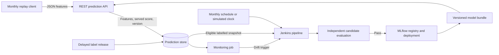

# Local deployment, drift monitoring, and monthly retraining

Proposed design for discussion, 25 September 2026. Target: a local Docker demonstration with twelve simulated months.

## Implementation status (28 September 2026)

The design below is now implemented; see [README.md](../README.md) for how to run it. Deviations from the original plan, and why:

| Plan | Implemented | Reason |
| --- | --- | --- |
| Evidently reports | Own PSI code in `drift.py` | Deterministic, testable, explainable on one slide; no extra dependency. |
| PSI >= 0.2 on 6 of 29 features | Importance-weighted drift share >= 0.25, or PSI >= 0.25 on one feature with >= 5 % importance, or alert-rate z >= 4 | `velocity_4w` drifts by PSI ~4.5 between real months but has only 2 % importance; counting features would alarm constantly. |
| Missingness +5 pp on any feature | Only on features that are normally < 5 % missing | Missingness in BAF is behaviour, not an error, and moves by up to 18 pp between real months. |
| Monthly label release (weekly mode optional) | Weekly release with a 4-week delay | Lets a drift alarm between two monthly runs use newer labels. |
| Drift incident queues training | Drift-triggered training waits until >= 3,000 applications from the drifted period are labelled | Retraining before that only refits old data. |
| 60,000 historical rows + 6 months | 150,000 historical rows + 24 weeks | Keeps enough fraud cases for the fit; configurable in `configs/retraining.json`. |
| Blue/green switch | Atomic `models/current.json` pointer + hot reload in the API, smoke test, automatic rollback | One API container; the old model keeps serving until the new one has loaded. |
| Scores as they come from the model | Class-weight prior correction (`scoring.py`) | The raw scores were ~10x too high; the API must return a probability. |

Added on top: a fairness metric (FPR ratio between age groups) in evaluation, gate reports and monitoring, and a comparison with a frozen copy of v1 (`simulation/summarize.py`).

## Model readiness

Freeze the selected `catboost-fpr-v1` model, run `2a4790d9e4484371b959f0511d87571a`, as the initial model. Its saved threshold is `0.36908183813581846`.

The existing reporting command was run once on the reserved 100,000-row test split, without fitting or changing the threshold:

| Metric | Validation | Initial test |
| --- | ---: | ---: |
| Recall | 59.27% | 57.63% |
| False-positive rate | 4.96% | 4.95% |
| Precision | 9.80% | 11.03% |
| Average precision | 0.1575 | 0.1769 |
| Applications flagged | 5.45% | 5.51% |

The test result is 608 frauds caught, 447 missed, and 4,902 legitimate applications flagged. Test metrics, charts, and model/data hashes are under `work/reports/initial_test_fpr_v1/`.

This is a reasonable starting model for the project demonstration. Scores should prioritize human review. They are uncalibrated estimates, particularly because the fitted model uses class weighting. A score of 0.37 should not be presented as an established 37% real-world fraud probability.

The approximate 95% Wilson interval for test FPR is 4.82%-5.09%; the empirical result below 5% does not establish that the population FPR is below 5%. If a strict operational ceiling is required later, select a threshold with headroom using development data and validate on a fresh holdout. Do not adjust this model using the test labels just inspected.

## Deployment and data flow

Use Docker Compose to run a small FastAPI service, PostgreSQL for prediction and label records, MLflow for runs and model versions, and Jenkins for monitoring/training/deployment jobs. Store immutable datasets and model bundles in persistent local volumes. Training runs separately from serving. CPU inference is the starting choice; measure latency and throughput before choosing worker counts. The current training configuration uses a GPU, so the training agent must provide one or explicitly record a CPU configuration as a separate run.

The API loads one immutable bundle at startup: native CatBoost model, matching preprocessing, feature schema, threshold, and model version. Check the preprocessing hash and use `prepare_features()` followed by `predict_proba(X)[:, 1]`. The currently logged generic MLflow prediction interface is not yet the required probability endpoint.

Use an MLflow `champion` alias to record the accepted version. Resolve it to an explicit version for deployment; changing an alias alone does not update a running service. Start and verify a replacement instance, switch the stable endpoint, and retain the previous version for rollback. The first implementation may use a controlled restart if brief downtime is explicitly accepted; uninterrupted reachability requires overlapping instances and a routing switch.

Protect prediction access with an API credential; label ingestion and deployment have separate privileges. Bind demo ports to localhost, keep Jenkins and MLflow private, and exclude secrets from source and prediction logs. These controls directly support the assignment's access requirement.

### Sending applications

Expose `POST /predict` and a bounded batch equivalent that share one scoring function. The replay client sends each 30,000-row month in chunks, initially 250 applications per request, through the actual REST API. Chunk size is a transport setting, not a drift window.

Each application contains:

- `application_id`, `event_time`, and `schema_version`.
- A `features` object with the 29 expected raw feature values. JSON `null` represents missing values; apply the existing sentinel-value rules on the server.
- No `fraud_bool`. Keep `source_id`, source dataset month, and simulated month as metadata, outside the model input.

Responses contain `prediction_id`, `application_id`, `fraud_score`, `flagged_for_review`, `threshold`, `model_version`, and `scored_at`. Store the exact feature snapshot and served output durably. An idempotency key and payload hash make retries return the original result without creating duplicate observations; intentional rescoring creates a distinct prediction event.

In a real integration, the application backend would construct these features. Several existing features describe historical activity, such as `velocity_6h` and `zip_count_4w`; they cannot be collected from a form alone. This demo replays already supplied values, while a real backend would need point-in-time feature computation.

### Sending labels

Release labels through a separate privileged import keyed by `application_id`, with `fraud_bool`, `label_available_at`, and label provenance. Never treat an unlabelled application as legitimate. Monitoring joins outcomes to the original served prediction, not a score recomputed by a newer model.

The simulator's private label files are not mounted into the API or made visible to training before release. Features and model scores cannot serve as replacement training labels. The simulation releases outcomes for all applications; a real implementation would also need a way to assess unflagged applications to avoid learning only from cases selected for review.

## Drift monitoring and actions

Use Evidently for distribution reports, with an explicit, versioned decision policy around those reports. Its default dataset drift rule and statistical thresholds are library defaults, not project requirements. Monitor missingness separately: ordinary distribution checks can omit missing values.

Run request schema checks immediately. Run drift reports on non-overlapping simulated weekly windows, normally about 7,500 applications, with a minimum of 5,000 valid unique applications; otherwise accumulate observations and report insufficient data. Summarize by month. This allows a drift trigger to occur before the next monthly training run.

Each deployed version has a frozen reference distribution from representative data available when it was accepted. Initially use the original validation feature distribution, clearly marked as a development reference. Keep a separate original reference for long-term comparisons. A previous healthy window can provide context, but must not replace the frozen reference automatically and hide gradual drift. After an accepted replacement, version its reference and score baseline explicitly.

The following are starting policies to calibrate on historical development windows and no-injected-change controls. They have not been validated as optimal thresholds:

| Signal | Initial rule | Action |
| --- | --- | --- |
| Input contract | Missing required field, invalid type, or non-finite numeric input | Reject/quarantine the record and record a data-quality incident. |
| Missingness | Increase of at least 5 percentage points on a feature | Warn immediately and investigate the source; quarantine affected training data if the issue is corruption. |
| Feature distribution | PSI at least 0.20 on at least 6 of 29 features, or at least 2 of 5 preselected important features, in two consecutive valid windows | Open one drift incident and request an early training run, subject to new labels and data quality. |
| Prediction distribution | Material score/flagged-rate change for the same deployed version | Warn and inspect workload and feature shifts; it is not proof of accuracy loss. |
| Labelled FPR | Observed FPR above 5% | Warn. Escalate on repeated mature cohorts or a 95% lower confidence bound above 5%. |
| Labelled recall | Drop of at least 5 percentage points versus the version's accepted reference, with at least 100 fraud labels | Warn and evaluate uncertainty; confirmed or persistent deterioration requests early training. |

For PSI, fix numerical bins from reference quantiles and categorical bins from reference categories, include explicit missing/new-category bins, and define smoothing for empty bins. Choose important features from training-only importance before replay. Backtest the combined incident rule, not just individual feature tests, because many simultaneous comparisons can produce noisy alerts.

Feature drift means the input population changed. It can justify retraining without proving the model degraded. Performance monitoring with delayed labels assesses the operational impact; performance loss can also occur without visible marginal feature drift. Check class prevalence alongside average precision and precision because their baselines change with prevalence.

An incident queues a Jenkins run only when there is a new eligible labelled snapshot and no equivalent job is running or completed. Use a one-simulated-week cooldown and coalesce overlapping monthly/drift requests. If labels have not arrived, retain a pending incident and run when eligible data arrives. If a pipeline bug caused the drift, repair the data source before training.

Alerts initially appear in the monitoring report and Jenkins build status. Record reason, affected features, window, sample counts, model version, and subsequent action. External messaging can be added separately.

## Retraining data and timing

Use a fresh CatBoost fit with the selected hyperparameters for each monthly run. Reuse the existing `train.py` entry point. Re-estimate tree count through early stopping and select the new model's threshold using validation only. A full Optuna search every month is unnecessary for this demonstration.

Explicit label convention: all labels from simulated month M become available at the start of M+1. This is a one-batch delay, not an exact 30-day delay for every individual application. Enforce eligibility using `label_available_at <= simulated_now`.

This convention has an important consequence: after a monthly run consumes the available labels, a mid-month drift alert cannot supply newer labelled training data. It queues an incident until the next release. To demonstrate useful retraining between monthly runs, add a separate mode that releases labels weekly after a one-month lag, using actual availability timestamps; split only the eligible rows in that mode. Alternatively, demonstrate the drift trigger independently with the monthly timer disabled and a fresh label release. Do not claim an early adaptation benefit from repeatedly fitting the same snapshot.

Recommended starting data policy:

- Bootstrap with the original 400,000 training rows while little new training history is available.
- Once at least three earlier labelled simulation months are available for fitting, try a bounded window of the latest six eligible fitting months plus a fixed, representative sample of 60,000 original training rows. Preserve natural class prevalence; keep class weighting inside model fitting.
- Keep the newest fully labelled month out of fitting: its first 15,000 rows are validation and its final 15,000 rows are the independent promotion holdout. Use preserved event order. These counts are starting values; accumulate more evaluation data if fraud counts are insufficient.
- The older monthly validation/holdout rows may enter fitting on later runs, after their evaluation role is finished. They cannot simultaneously serve as an independent evaluation set for that later run.

The six-month window and 60,000-row historical sample are hypotheses to compare against an expanding-history baseline using chronological development backtests. They are intended to allow adaptation while retaining older patterns, not to guarantee improvement. If they perform worse, retain the expanding policy. In either case, exclude evaluation rows by application/source identity, not merely by file name.

Example at the start of simulated month 8: month 7 labels have arrived; train on eligible months 1-6 plus historical data, choose early stopping and threshold using the first half of month 7, and compare candidate and incumbent on the second half. Then score month 8 using the accepted model. Month 8 labels remain inaccessible.

The first monthly retraining at the start of month 2 has no earlier simulation month available for fitting; it can fit on original training data with fresh month-1 validation and evaluation. This intentionally spends the newest data on an honest comparison. From month 3 onward, earlier simulation rows also enter fitting.

Data roles:

| Existing data | Role |
| --- | --- |
| Original training, 400,000 rows | Initial fit and historical training sample. |
| Original validation, 100,000 rows | Already used for tuning; initial drift reference and development work, not an independent promotion holdout. |
| Initial test, 100,000 rows | The initial model assessment just performed; never monthly tuning or promotion selection. |
| Simulation pool, 360,000 rows | Twelve disjoint 30,000-row application cohorts, with delayed labels and evolving data roles. |
| Reserve, 40,000 rows | Keep closed for a separately defined terminal audit; not available for initial or monthly tuning. |

Log the selected row identities, available-label cutoff, hashes, split boundaries, seed, code/environment version, and selection policy for each run. One snapshot may produce at most one candidate selection attempt per policy; repeated search on the same promotion holdout turns it into development data.

## Candidate acceptance and deployment

Monthly scheduling means a monthly training/evaluation attempt, not automatic replacement.

Evaluate incumbent and candidate on exactly the same newest promotion holdout, each using its own previously fixed threshold. This rescoring comparison is distinct from monitoring the original served predictions. Require valid data, adequate class counts, empirical candidate FPR below 5%, acceptable review volume, and a useful recall benefit or clear correction of the incumbent's FPR violation. Report confidence intervals and paired uncertainty for metric differences; keep the incumbent when evidence is inconclusive. Final improvement and workload tolerances should be set from development backtests before replay.

An empirical FPR gate meets a demonstration policy but does not guarantee a strict population limit. A stronger policy would require the upper confidence bound below 5%, with threshold headroom selected on validation; the current initial model has not established that stronger condition.

Jenkins stages: validate snapshot -> fit -> evaluate -> register candidate -> apply acceptance policy -> start replacement -> check readiness and prediction contract -> switch endpoint -> verify reported version. Failed evaluation retains the incumbent. Failed deployment restores the previous bundle/version. Update the champion alias in concert with verified deployment, and record failed attempts without labelling them active.

Store trigger reason, candidate/incumbent metrics, decision, deployed version, and rollback status in MLflow/Jenkins. Prevent concurrent deployments. The API must expose readiness and model-version information so the replay verifies the service after every attempt, including rejected candidates.

## Twelve-month demonstration

Preserve the existing source ordering and create twelve disjoint 30,000-row batches. The source `month` covers only part of the BAF dataset's original timeline; these twelve batches are artificial time steps, not twelve genuine calendar months.

Use a fixed seed and a recorded scenario manifest. Include no-injected-change controls, progressively stronger feature changes, a persistent shift, and a missingness/new-category incident. The source data already has temporal variation, so no-injected-change controls are not guaranteed stationary.

Keep original labels attached to original source identities. Feature perturbations with unchanged labels demonstrate robustness to changed/corrupted measurements; do not automatically describe them as pure covariate drift or genuine new fraud behavior. A separate concept-drift experiment needs an explicit synthetic change in the feature-to-label rule and must be identified as such. Random label flipping alone is label noise.

At each monthly boundary, release the previous cohort's labels, evaluate its served predictions, and run the scheduled Jenkins job. Replay the next cohort in weekly windows, checking drift between windows. Finish with a month-13 label release and training job to complete twelve monthly retraining attempts and evaluate month 12. Verify the final model's API; its future predictive performance remains unmeasured because no month-13 applications were replayed.

Also score a frozen copy of the initial model in an isolated offline comparison on every month. Compare adaptive versus frozen-model results on each subsequent unseen cohort, with actual model versions and thresholds recorded. Retraining does not necessarily improve every month; rejected or unsuccessful candidates are meaningful results.

Use Jenkins parameters for an accelerated simulated clock so a year can be demonstrated in one session. The same pipeline can have a real monthly Jenkins schedule. No Codex reminder or background automation is required for this design.

## Implementation order

1. Package the selected bundle and build the API, data contract, durable prediction log, and smoke checks.
2. Build replay and delayed-label ingestion with deterministic manifests and leakage checks.
3. Add monitoring, reference datasets, incident state, and trigger decisions.
4. Add Jenkins training, independent candidate gates, model registration, deployment, and rollback.
5. Run the complete year and export comparative results and the architecture diagram.

All five steps are implemented. The tests are in `tests/` (`python -m unittest discover -s tests -t .`).

## References

- Assignment, Task 3: `task/Task_Oral Project Report_DLBDSMTP01 (2).pdf`, page 4. Requires a REST service, access control, monitoring, platform-triggered monthly/drift training and deployment, and a one-year simulation; cloud hosting is optional.
- [Evidently data drift reports](https://docs.evidentlyai.com/metrics/preset_data_drift) support reference/current comparisons and configurable dataset drift rules.
- [Evidently drift methods](https://docs.evidentlyai.com/metrics/explainer_drift) explain defaults and the need for separate missingness monitoring.
- [MLflow registry workflows](https://www.mlflow.org/docs/latest/ml/model-registry/workflow/) document version registration and aliases.
- [Jenkins Pipeline syntax](https://www.jenkins.io/doc/book/pipeline/syntax/) documents parameterized jobs and scheduled triggers.
- [BAF authors' repository](https://github.com/feedzai/bank-account-fraud) describes the synthetic bank-account-fraud data and its temporal dynamics. It provides an engineering proxy, not evidence of accuracy on actual benefit applications.
